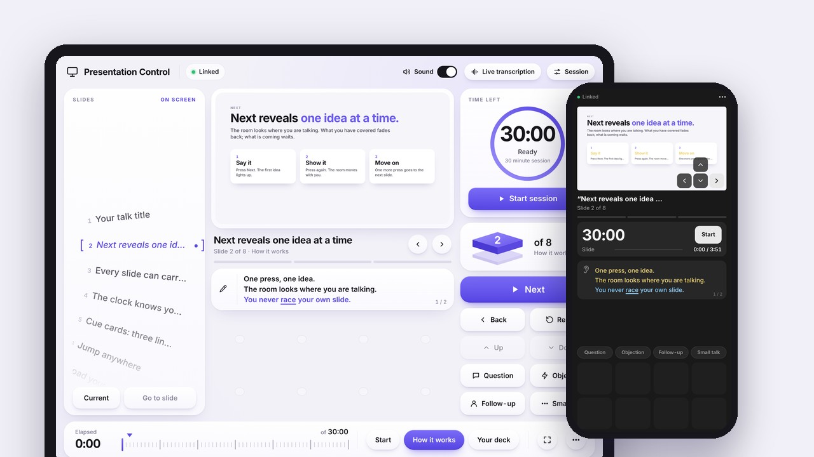

# Vincent Bish

I make institutions adopt things: a 60-day migration of 80,000 people at the U.S. Department of Health and Human Services, a cabinet-level agency; enterprise rollouts at Slack; secure deployments where clearance came before code. This repository is the public side of that work: what I build, how I think, and things you can try.

**Site:** [vincentbish.com](https://vincentbish.com) · **LinkedIn:** [linkedin.com/in/vincentbish](https://www.linkedin.com/in/vincentbish)

---

## Second Chair: presentation control for iPhone and iPad

Your computer shows the slides; your phone or tablet runs the talk. A slide wheel you browse without the room seeing, pacing in plain words, cue cards, and one-tap backup slides for the questions you expect.

- **Watch it:** [Second Chair in 3D, 17 seconds](media/second-chair-slantit.mp4) (made with Slant it) · [plain iPad walkthrough](media/second-chair-ipad-walkthrough.mp4)
- **Try it free in your browser:** [vincentbish.com/second-chair](https://vincentbish.com/second-chair/) (open it on an iPad, sideways). The preview runs the sample deck.
- **Get the full version:** [Second Chair on Gumroad](https://6622888999216.gumroad.com/l/second-chair). Loads any deck from a PDF, runs the audience screen, keeps phone and tablet in sync, optional live transcription, and a Claude skill that builds a full deck from your notes.

## Case studies

| Case | Question | Read |
|---|---|---|
| **Uber** | The commodification of risk: Uber's commercial history and present reality through Substrate Architecture Theory, the Liability Orchestrator versus the Liability Anchor | [Web](https://vincentbish.com/casestudies/uber/) · [PDF](case-studies/uber-the-commodification-of-risk.pdf) |
| **Eckerd Connects** | The New York Thesis: where a youth and workforce nonprofit's margin hides, and why New York opens the fastest path to diversified revenue | [Web](https://vincentbish.com/casestudies/eckerd/) · [PDF](case-studies/eckerd-the-new-york-thesis.pdf) |
| **Legora** | The Supervisory Bottleneck: when generative artificial intelligence multiplies associate drafts, signing partners become the constraint | [Web](https://vincentbish.com/casestudies/legora/) · [PDF](case-studies/legora-the-supervisory-bottleneck.pdf) |

Independent analysis from public sources. None of these was prepared for, reviewed by, or endorsed by the company it studies.

## Study work: the European Union Artificial Intelligence Act, Article 5, and child harm

**A proposed Article 5 policy design model for trust and safety teams.** Article 5 prohibits artificial intelligence practices that exploit the vulnerabilities of children, but it does not tell a trust and safety team how to recognize psychological harm before a product ships. The Composite Child Harm Assessment Code (CCHAC) scores harm on four dimensions: developmental stage, harm type, intensity and likelihood, so a policy team can assess, compare and report it consistently across products, markets and cultures.

- **Slide through it:** [vincentbish.com/cchac](https://vincentbish.com/cchac/) (30 slides, arrow keys or swipe)
- **PDF:** [cchac/cchac-study.pdf](cchac/cchac-study.pdf) (3.5 MB)
- **Works consulted, by field:** [cchac/BIBLIOGRAPHY.md](cchac/BIBLIOGRAPHY.md)

Built at Harvard. Independent study work; not affiliated with or endorsed by any company named in it.

## How I work

- I start from incentives, not stated wants: who has to say yes, what they are measured on, and what it costs them.
- I look for the anomaly the current model can't explain; it usually marks the missing variable.
- I make the graphic do the reasoning: one picture an expert understands cold.
- I ship the playbook with the work, so the next team starts where I finished.
